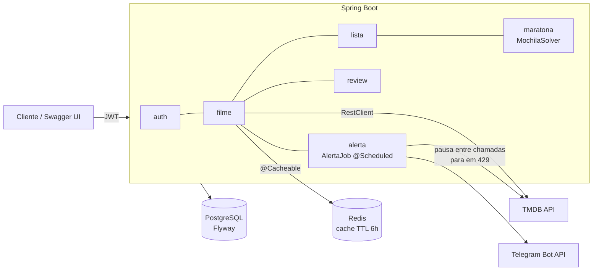
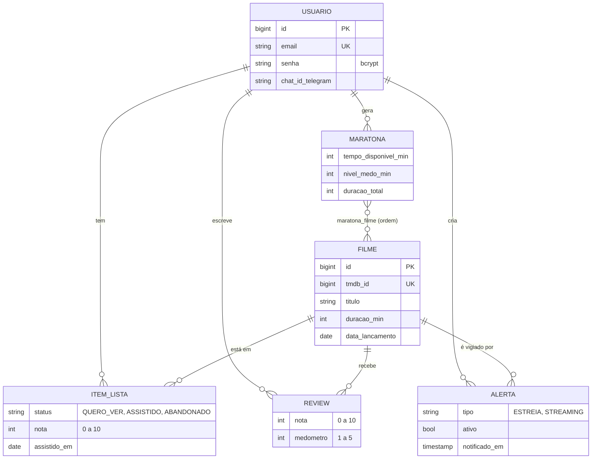

# 🩸 Horror Movie Hub

API para fãs de filmes de terror: lista pessoal, reviews com **medômetro** (1–5), alertas de estreia e de chegada ao streaming pelo Telegram, e um **gerador de maratona** que escolhe os melhores filmes que cabem no tempo que você tem.

[](https://github.com/DougVec/Horror-Movies-Hub/actions/workflows/ci.yml)

**Stack:** Java 21 · Spring Boot 3.5 (Web, Data JPA, Security, Validation, Cache, Scheduling) · PostgreSQL + Flyway · Redis · JWT (OAuth2 Resource Server) · TMDB API · Telegram Bot API · JUnit 5, Mockito, Testcontainers · Docker Compose · GitHub Actions · springdoc-openapi

---

## Destaques

### 1. Integração resiliente com API externa
- Respostas da TMDB ficam em **cache no Redis** (TTL de 6h), com chave normalizada (`"Shining "` e `"shining"` usam a mesma entrada).
- **Redis fora do ar não derruba a API**: um `CacheErrorHandler` loga e segue direto para a TMDB.
- Falhas da TMDB viram respostas limpas: 404 → 404, 429 → 503, qualquer outra → 502, sem vazar detalhes internos.
- Filmes buscados são **persistidos localmente** (upsert por `tmdbId`); a duração, que só vem no endpoint de detalhe, é completada sob demanda.

### 2. Gerador de maratona = problema da mochila 0/1
Escolher filmes para caber em X minutos maximizando a "qualidade" é exatamente a [mochila 0/1](https://en.wikipedia.org/wiki/Knapsack_problem):

| Mochila | Maratona |
|---|---|
| capacidade | tempo disponível (min) |
| peso do item | duração do filme |
| valor do item | `0.6 × nota + 0.4 × (2 × medômetro)` |

Resolvido com **programação dinâmica** em `O(n × tempo)` ([`MochilaSolver`](src/main/java/com/douglas/horrorhub/maratona/MochilaSolver.java)), com reconstrução da escolha pela tabela. Os testes cobrem casos-limite e casos em que **o guloso erra**:

> 180 min, filmes de 160 min (valor 9), 90 min (7) e 90 min (7).
> Guloso por valor pega o de 160 e sobram 20 min → **9**. A DP pega os dois de 90 → **14**.

A maratona sai ordenada do **menos para o mais assustador**, para ir esquentando.

### 3. Job de notificações
[`AlertaJob`](src/main/java/com/douglas/horrorhub/alerta/AlertaJob.java) roda a cada 6h e avisa no Telegram quando um filme **estreia** ou **chega a um streaming no Brasil** (Netflix, Max…):
- **Uma consulta por filme por rodada**, mesmo com N usuários esperando o mesmo filme.
- **Pausa entre chamadas** para ficar abaixo do rate limit da TMDB; num **429 a rodada para** e o restante fica para a próxima.
- Falha no Telegram mantém o alerta ativo para nova tentativa; falha em um filme não afeta os outros.
- O token do bot vai na URL do Telegram, então erros são logados **sem a mensagem da exceção**, para não vazar o token.

---

## Arquitetura



Pacotes organizados **por feature** (`auth`, `filme`, `lista`, `review`, `maratona`, `alerta`, `shared`), não por camada.

### Modelo de dados



Regras de integridade ficam também no banco: `UNIQUE (usuario_id, filme_id)` em lista e review, `CHECK` em nota e medômetro.

### Fluxo do job de alertas

```mermaid
sequenceDiagram
    participant J as AlertaJob
    participant DB as PostgreSQL
    participant T as TMDB
    participant TG as Telegram
    J->>DB: alertas ativos (join usuario, filme)
    loop cada alerta com chatId
        alt filme ainda não consultado nesta rodada
            J->>J: pausa (300ms)
            J->>T: /movie/{id} ou /watch/providers
            T-->>J: data de lançamento / serviços BR
        end
        opt estreou ou está em streaming
            J->>TG: sendMessage
            J->>DB: ativo = false, notificado_em = agora
        end
    end
    Note over J,T: 429 da TMDB → encerra a rodada; o resto fica para a próxima
```

---

## Endpoints

Documentação interativa em **`/swagger-ui.html`** (faça login, clique em *Authorize* e cole o token).

| Método | Rota | Auth | Descrição |
|---|---|:-:|---|
| POST | `/auth/registro` | | cria conta (senha 8–72 caracteres, guardada com bcrypt) |
| POST | `/auth/login` | | devolve JWT (2h) |
| PUT | `/usuarios/me/telegram` | ✅ | `{ "chatId": "123" }` para receber alertas |
| GET | `/filmes/busca?q=` | | busca na TMDB (só terror), salva no hub |
| GET | `/filmes/{id}` | | detalhes + média de nota e medômetro da comunidade |
| GET | `/filmes/em-breve` | | próximas estreias de terror no Brasil |
| GET | `/filmes/em-alta` | | mais bem avaliados no hub (mín. 3 reviews) |
| GET | `/filmes/{id}/reviews?page=&size=` | | reviews paginadas, mais recentes primeiro |
| POST | `/filmes/{id}/reviews` | ✅ | `{ "texto", "nota": 0-10, "medometro": 1-5 }`, uma por usuário |
| GET | `/minha-lista?status=` | ✅ | sua lista, filtrável por status |
| POST | `/minha-lista` | ✅ | `{ "filmeId", "status"? }` |
| PATCH | `/minha-lista/{id}` | ✅ | `{ "status"?, "nota"? }` |
| DELETE | `/minha-lista/{id}` | ✅ | remove |
| POST | `/maratonas/gerar` | ✅ | `{ "tempoMin": 300, "nivelMedoMin": 3, "apenasQueroVer": true }` |
| GET | `/maratonas` | ✅ | histórico (20 mais recentes) |
| GET | `/alertas` | ✅ | seus alertas |
| POST | `/alertas/{filmeId}?tipo=ESTREIA\|STREAMING` | ✅ | cria alerta |
| DELETE | `/alertas/{filmeId}?tipo=` | ✅ | remove (sem `tipo`, remove os dois) |

**Regras da lista:** virar `ASSISTIDO` marca a data; sair de `ASSISTIDO` limpa data e nota; nota só em filme assistido (422). Item de outro usuário responde 404, igual a inexistente.

Erros seguem o formato [RFC 9457 Problem Details](https://www.rfc-editor.org/rfc/rfc9457).

---

## Como rodar

Pré-requisitos: Java 21+, Maven, Docker.

```bash
docker compose up -d
```

```bash
TMDB_TOKEN=seu_token_v4 mvn spring-boot:run
```

A API sobe em `http://localhost:8080` e o Flyway cria o schema.

| Variável | Para quê | Padrão |
|---|---|---|
| `TMDB_TOKEN` | token de leitura v4 da [TMDB](https://www.themoviedb.org/settings/api) | — (busca falha com 502) |
| `JWT_SECRET` | segredo HS256 (≥ 32 bytes) | valor de dev, **troque em produção** |
| `TELEGRAM_BOT_TOKEN` | token do bot ([@BotFather](https://t.me/BotFather)) | vazio = mensagens só no log |

Para receber alertas: mande uma mensagem ao seu bot, pegue o `chat.id` em `https://api.telegram.org/bot<TOKEN>/getUpdates` e envie para `PUT /usuarios/me/telegram`.

## Testes

```bash
mvn verify
```

48 testes:
- **Unitários**: `MochilaSolver` (casos-limite e guloso vs. ótimo), pontuação e filtros da maratona, regras de status da lista, autenticação/JWT, parsing da TMDB com `MockRestServiceServer`, e 10 cenários do job de alertas (dedupe, 429, falha no Telegram…).
- **Integração** ([`HorrorHubIntegrationTest`](src/test/java/com/douglas/horrorhub/HorrorHubIntegrationTest.java)): sobe a aplicação inteira com **Postgres e Redis reais via Testcontainers** e percorre busca → lista → review → maratona → alerta por HTTP. Como `ddl-auto=validate`, o teste também garante que entidades e migrations batem.

O CI ([`.github/workflows/ci.yml`](.github/workflows/ci.yml)) roda `mvn verify` a cada push e PR.

## Limitações conhecidas

- O job de alertas roda em todas as instâncias; com mais de uma réplica, usar ShedLock para não notificar em dobro.
- A data de estreia usada é a data principal da TMDB, não a específica do Brasil.
- Na maratona com "hub inteiro" só entram filmes com duração já conhecida, para não disparar uma chamada à TMDB por filme.

## Próximos passos

- Front simples (React ou Thymeleaf)
